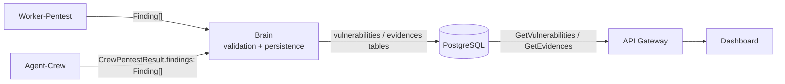

# Structured Proof Contract

| | |
|---|---|
| **Version** | `1.0.0` |
| **Status** | Implemented per recommendations D1–D7 ([decisions, FR](../fr/proof-contract-decisions.md)). Sign-off from Charly (producer) and Noé (Dashboard) to be obtained in PR review. |
| **Author** | Antoine |
| **Date** | 2026-10-30 |
| **Scope** | Every vulnerability and every proof produced by a scan, whatever its source (Worker-Pentest or Agent-Crew) |
| **Related schemas** | [`aegis/v2/vulnerability.proto`](../../aegis/v2/vulnerability.proto) (`Vulnerability`, `Evidence`) |

> The French version ([`../fr/proof-contract.md`](../fr/proof-contract.md)) is
> the reference. This translation must be kept in sync with it.

This document is the **single reference** for what a proof is in Aegis AI. The
`.proto` describes what the Dashboard *reads*; this contract also describes what
producers *must emit* for that read to be correct. When this document and the
code disagree, this document wins and the code is at fault.

**MUST**, **MUST NOT**, **SHOULD** and **MAY** are used as in RFC 2119.

---

## 1. Overview



Guiding principle: **one finding schema for every producer.** Worker-Pentest
and Agent-Crew emit the same `Finding` object (§2). The Brain performs no format
translation: it **validates** on ingestion, recomputes the proof level, then
persists (§6).

Reference implementation:

| Role | Code |
|---|---|
| Worker producer | `Aegis-AI-Worker-Pentest/src/proof.py` (`tag_finding`) |
| Crew producer | `Aegis-AI-Agent-Crew/src/proof_verification.py`, `src/tool_ledger.py` |
| Validation, dedup | `Aegis-AI-Brain/src/services/proof_contract.py` |
| Derivation on read | `Aegis-AI-Brain/src/grpc_services/vulnerabilities.py` |
| Display | `Aegis-AI-Dashboard/src/components/ui/ProofBadge.tsx` |

---

## 2. `Finding` object (emitted by producers)

A `Finding` is a JSON object. Every producer MUST emit a list of `Finding`
conforming to this schema.

### 2.1 Fields

| Field | Type | Required | Rule |
|---|---|---|---|
| `vuln_type` | string | **yes** | Vulnerability class label, from the registry in §2.2. Not empty. |
| `severity` | enum | **yes** | Exactly one of `CRITICAL`, `HIGH`, `MEDIUM`, `LOW`, `INFO` (upper case). |
| `target_endpoint` | string | **yes** | Absolute URL of the attacked endpoint, scheme included, without the payload value. E.g. `http://10.0.0.5:8080/search?q=`. The field MUST be present; it SHOULD be non-empty. |
| `description` | string | **yes** | Human-readable explanation. Not empty. |
| `evidences` | `Evidence[]` | **yes** | List (§3). At least **1** item whenever `proof_level` is `detected` or `exploited`; MAY be empty for `unverified`. |
| `source` | enum | **yes** | `worker-pentest` or `agent-crew`. MUST match the channel the finding arrives on. |
| `proof_level` | enum | **yes** | `exploited`, `detected` or `unverified` (§4). |
| `confidence` | enum | no | `CONFIRMED`, `LIKELY` or `SUSPECTED`: how sure the *interpretation* is, independent of `proof_level`. On the Worker side it lives in `loot_data.confidence`. |
| `loot_proof` | string | no | Convenience copy, see §5. Ignored by the Brain on write. |
| `exfiltrated_data` | array | no | Convenience copy, see §5. Ignored by the Brain on write. |

Any other field MAY be present (e.g. `exfiltration` on the Worker side); it is
kept as-is but has no contractual value.

> Compatibility: a finding without `source` or `proof_level` is accepted; the
> Brain assigns `source` from the channel and computes `proof_level` (§4).

### 2.2 `vuln_type` registry

Values emitted in v1:

| Value | Used by |
|---|---|
| `SQL Injection (SQLi)` | Worker-Pentest (`sqli-probe`, `sqlmap`), Agent-Crew |
| `Cross-Site Scripting (XSS)` | Worker-Pentest (`xss-probe`) |
| `SERVER_MISCONFIGURATION` | Worker-Pentest (`nikto`) |
| `TOOL_EXECUTION_ERROR` | Worker-Pentest (tool failure, always `unverified`) |

A producer that identifies a class missing from the registry SHOULD request its
addition rather than invent a label: two labels for the same class break
deduplication (§7). The Brain does not reject an unknown label in v1.

---

## 3. `Evidence` object

An `Evidence` is **one tool call and what it yielded.**

| Field | Type | Required | Rule |
|---|---|---|---|
| `payload_used` | string | **yes** | Not empty. The exact payload sent to the target, or the exact tool call (`<tool> <JSON arguments>`). |
| `loot_data` | object | **yes** | What was observed. Structure in §3.1. |

`captured_at` and `id` are assigned by the Brain on insert; a producer MUST NOT
provide them.

### 3.1 `loot_data` structure

`loot_data` is the **single source of truth** for the proof: it is the only
persisted field (column `evidences.loot_data`, JSONB), and the Brain derives
`loot_proof` and `exfiltrated_data` from it on read (§5).

Common metadata (Worker: `build_proof_metadata`):

| Key | Type | Required | Rule |
|---|---|---|---|
| `tool` | string | **yes** | Tool that produced the observation (`sqli-probe`, `sqlmap`, `nikto`, CrewAI tool name…). |
| `status` | enum | **yes** | `SUCCESS`: the tool ran and observed the target. `ERROR`: the tool failed. `UNVERIFIED` (Crew): the excerpt was not found in the tool's real output. |
| `confidence` | enum | no | `CONFIRMED`, `LIKELY`, `SUSPECTED` or `N/A`. |

Proof keys:

| Key | Type | Required | Rule |
|---|---|---|---|
| `seed_flag_expected` | string | if `exploited` | Always `aegis-flag-1234` in v1. |
| `seed_flag_extracted` | bool | if `exploited` | `true` only if `seed_flag_expected` literally appears in the extracted data. |
| `exfiltration` | object | if `exploited` | See below. |
| `response_excerpt` | string | if `agent-crew` | **Raw** excerpt of the tool output (≤ 4096 characters), copied verbatim. See §4.2. |
| `sql_error` / `sql_error_signature` | string | no | SQL error message or signature returned by the target, verbatim. |
| `http_status_code` | int | no | HTTP status of the response, when the tool has it. |

`loot_data.exfiltration` object:

| Key | Type | Rule |
|---|---|---|
| `confirmed` | bool | `true` if data was extracted. |
| `proof_marker` | string | `aegis-flag-1234` if the flag was extracted, otherwise empty string. |
| `records_extracted` | int | Total number of records obtained (Worker). |
| `extracted_fields` | string[] | Names of the columns or fields obtained, sorted (Worker). |
| `sensitive_data_types` | string[] | Sensitive categories detected (Worker). |
| `sample_records` | object[] | **At most 3** records (§5.3). |

Other keys MAY be added to `loot_data` (`request`, `transport`, `raw_output`…);
the Dashboard shows them as-is.

---

## 4. Proof level and success criterion

### 4.1 The three levels

| `proof_level` | Meaning | Condition (computed from the evidences) |
|---|---|---|
| `exploited` | Exploitation is **proven**. | At least one evidence with `seed_flag_extracted == true` **and** `exfiltration.proof_marker == "aegis-flag-1234"`. For `agent-crew`, the evidence MUST also be observed (below) and the flag MUST appear in `response_excerpt`. |
| `detected` | A tool **actually observed** the vulnerability, without demonstrated extraction. | At least one observed evidence: `loot_data.status == "SUCCESS"`, and for `agent-crew` a non-empty `response_excerpt`. |
| `unverified` | Hypothesis or tool failure, **without verifiable trace**. | Neither of the above. |

`proof_level` says *what can be proven*; `confidence` says *how sure the tool is
of its interpretation*. A `SUSPECTED` nikto run that completed is `detected`; a
`CONFIRMED` LLM claim with no tool output is `unverified`.

### 4.2 Anti-hallucination rule (Agent-Crew)

The LLM that structures Crew findings re-reads the Markdown report: its
excerpts can be paraphrased or invented. Verification therefore happens in two
steps.

1. **In the Crew** (`tool_ledger.py`, `proof_verification.py`). Every tool call
   during `crew.kickoff()` is recorded with its arguments and real output. An
   evidence is `SUCCESS` only if its `response_excerpt` (≥ 12 characters,
   whitespace-normalized) appears **verbatim** in the output of a call to **the
   same tool** that did not fail (`[FAILED]`, `[BLOCKED]`, `[ERROR]`).
   Otherwise it is `UNVERIFIED`. For a verified evidence, `payload_used` is
   replaced by the call actually recorded, not by what the LLM claims was sent.
2. **In the Brain** (`proof_contract.py`). The Brain does not see tool outputs;
   it recomputes the §4.1 level from the evidences and **downgrades** any
   declared `proof_level` that is not justified. It never **upgrades** it.

If a tool runs outside the recording context, its call is not recorded and the
finding stays `unverified`: verification fails closed.

### 4.3 Scan success criterion

> A scan is an **exploitation success** if and only if at least one of its
> persisted findings is `exploited`, that is, if the string `aegis-flag-1234`,
> injected during seeding, was extracted from the target.

This is the criterion checked by `Aegis-AI-Infra/scripts/verify-mvp-pipeline.sh`
(`EXPECTED_FLAG`). `detected` and `unverified` findings are displayed but do not
count toward it.

---

## 5. `loot_proof` and `exfiltrated_data`

### 5.1 Semantics

| Field | Question it answers | Shape |
|---|---|---|
| `loot_proof` | "What **proves** the attack worked?" | A **short string**: the extracted flag, or failing that the SQL error message or signature. |
| `exfiltrated_data` | "What **leaked**?" | A **sample** of the records obtained, serialized as JSON. |

These are **derived fields**: the Dashboard receives them in `Vulnerability`
(proto fields 7 and 8), but they are **not stored** in the `vulnerabilities`
table.

### 5.2 Derivation rule (normative)

The Brain picks **one** evidence per vulnerability: first an evidence whose
`loot_data.seed_flag_extracted` is `true`, otherwise the most recent one
(`captured_at`). It then computes:

```text
loot_proof       = loot_data.loot_proof
                   || loot_data.exfiltration.proof_marker
                   || loot_data.sql_error
                   || loot_data.sql_error_signature
                   || ""

exfiltrated_data = json(loot_data.exfiltrated_data
                        || loot_data.exfiltration.sample_records
                        || loot_data.sample_records)
                   || ""
```

**Consequence for producers:** a `loot_proof` or `exfiltrated_data` placed only
at the top level of the `Finding` is **lost**. Every proof MUST live in
`evidences[].loot_data` per §3.1.

### 5.3 Constraints on exfiltrated data

- `sample_records` contains **at most 3** records.
- Targets are sandboxes fed by seeding; `exfiltrated_data` MUST contain only
  seeding data. If a producer observes data that does not come from seeding, it
  MUST replace it with `"[REDACTED]"` and say so in `description`.

---

## 6. Responsibilities

| Step | Owner | What it does |
|---|---|---|
| Emission | **Producer** (Worker-Pentest, Agent-Crew) | Emits `Finding`s conforming to §2–§4, with `source` and `proof_level`. Mapping to this schema is **its job**, as close as possible to the tool that produced the observation. |
| Validation | **Brain**, on ingestion (`GraphDrivenPentestWorkflow._ingest_findings`) | Validates each `Finding`. A non-conforming finding is **rejected** and logged (`🚫 scan=… rejected <source> finding: <reason>`), never repaired. Recomputes `proof_level` (§4.2). |
| Persistence | **Brain** | Deduplicates (§7), then inserts via `save_vulnerabilities`, with `source` and `proof_level`, **whatever the source**. The PDF receives the same list. |
| Derivation | **Brain**, on read | Computes `loot_proof` / `exfiltrated_data` per §5.2 and exposes `source` / `proof_level` (proto fields 9 and 10). |
| Display | **Dashboard** | Shows a proof-level badge (`Exploitée`, `Détectée`, `Non vérifiée`), with the source in the tooltip. `unverified` findings are shown, not hidden. Does not recompute the proof. |

The Crew Markdown report (`final_report_markdown`) remains stored in
`scans.crew_report_markdown` as **narrative**. It is not a proof.

---

## 7. Cross-producer deduplication

Two findings are **the same** if they share the pair
(`vuln_type`, `target_endpoint`).

On duplicates:

1. Keep the finding with the strongest `proof_level`
   (`exploited` > `detected` > `unverified`).
2. On a tie, keep the `worker-pentest` one (deterministic and reproducible).
3. The `evidences` of the dropped finding are **merged** into the kept one,
   deduplicated on (`payload_used`, `loot_data`).

This also applies across tools of the same producer: `sqli-probe` and `sqlmap`
on the same endpoint yield a single vulnerability with two evidences.

---

## 8. Versioning

This contract follows SemVer, independently of proto package versions.

| Change | Version |
|---|---|
| Field removed or renamed, optional field made required, enum value removed, change to the §5.2 rule or the §4.3 criterion | **major** |
| New optional field, new `vuln_type` or enum value | **minor** |
| Clarification with no behavioural effect | **patch** |

Any major change requires agreement from the producer and the Dashboard
consumer before merge, and an entry in the history below.

---

## 9. Examples

### 9.1 Worker-Pentest - proven exploitation

```json
{
  "vuln_type": "SQL Injection (SQLi)",
  "severity": "CRITICAL",
  "target_endpoint": "http://10.0.0.5:8080/search?q=",
  "description": "UNION-based SQL injection on parameter q. Exfiltration proof: seeding string aegis-flag-1234 was extracted.",
  "source": "worker-pentest",
  "proof_level": "exploited",
  "evidences": [
    {
      "payload_used": "' UNION SELECT id, name, email, secret FROM users--",
      "loot_data": {
        "tool": "sqli-probe",
        "status": "SUCCESS",
        "confidence": "CONFIRMED",
        "http_status_code": 200,
        "seed_flag_expected": "aegis-flag-1234",
        "seed_flag_extracted": true,
        "exfiltration": {
          "confirmed": true,
          "proof_marker": "aegis-flag-1234",
          "records_extracted": 4,
          "extracted_fields": ["email", "id", "name", "secret"],
          "sensitive_data_types": ["email", "secret"],
          "sample_records": [
            {"id": 1, "name": "admin", "email": "admin@corp.local", "secret": "aegis-flag-1234"}
          ]
        }
      }
    }
  ]
}
```

Derived for the Dashboard: `loot_proof = "aegis-flag-1234"`,
`exfiltrated_data = "[{\"id\": 1, ...}]"`.

### 9.2 Worker-Pentest - detection via SQL error

```json
{
  "vuln_type": "SQL Injection (SQLi)",
  "severity": "CRITICAL",
  "target_endpoint": "http://10.0.0.5:8080/search?q=",
  "description": "The target returns a raw SQL error in response to a quote.",
  "source": "worker-pentest",
  "proof_level": "detected",
  "evidences": [
    {
      "payload_used": "'",
      "loot_data": {
        "tool": "sqli-probe",
        "status": "SUCCESS",
        "confidence": "SUSPECTED",
        "http_status_code": 500,
        "sql_error": "SQL syntax error near '''",
        "error_based_sqli": true
      }
    }
  ]
}
```

Derived: `loot_proof = "SQL syntax error near '''"`, `exfiltrated_data = ""`.

### 9.3 Agent-Crew - verified excerpt

```json
{
  "vuln_type": "Exposed configuration file",
  "severity": "HIGH",
  "target_endpoint": "http://10.0.0.5:8080/.env",
  "description": "The .env file is publicly readable and exposes credentials.",
  "source": "agent-crew",
  "proof_level": "detected",
  "confidence": "CONFIRMED",
  "evidences": [
    {
      "payload_used": "Verify Exposed Configuration File {\"file_path\": \"/.env\", \"host\": \"10.0.0.5\", \"port\": 8080, \"scheme\": \"http\"}",
      "loot_data": {
        "tool": "Verify Exposed Configuration File",
        "status": "SUCCESS",
        "confidence": "CONFIRMED",
        "response_excerpt": "DB_HOST=postgres DB_PASSWORD=hunter2"
      }
    }
  ]
}
```

Had the excerpt not been found in the tool's real output, the evidence would
have `status: "UNVERIFIED"` and the finding would be `unverified`.

---

## 10. Known limitations of v1.0.0

| # | Limitation | Repository |
|---|---|---|
| 1 | Vulnerabilities saved before migration `20261030_0002` have no `source` or `proof_level`; the Dashboard shows no badge for them. | Brain, Dashboard |
| 2 | `TOOL_EXECUTION_ERROR` findings are persisted as vulnerabilities (`INFO`, `unverified`). They are tool incidents, not flaws. | Worker-Pentest |
| 3 | The Brain does not reject a `vuln_type` outside the registry (§2.2). | Brain |
| 4 | Crew verification assumes CrewAI runs tools within the `kickoff()` context. Otherwise every Crew finding stays `unverified` (fails closed). | Agent-Crew |

---

## History

| Version | Date | Change |
|---|---|---|
| `1.0.0-draft` | 2026-10-30 | First draft. Formalizes the implicit Worker-Pentest contract and extends it to Agent-Crew. |
| `1.0.0` | 2026-10-30 | Decisions D1–D7 applied and implemented. `loot_data` carries the `tool`/`status`/`confidence` metadata; evidences optional for `unverified`; `sql_error_signature` added to derivation; flag-first evidence choice (D5); Crew excerpts verified against tool outputs. |

---

*Aegis AI Contract Engineering - 2026*
