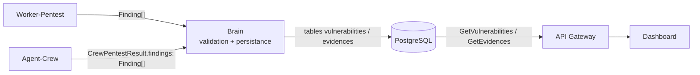

# Contrat de preuve structurée

| | |
|---|---|
| **Version** | `1.0.0` |
| **Statut** | Implémenté selon les recommandations D1–D7 ([décisions](proof-contract-decisions.md)). Validation de Charly (producteur) et Noé (Dashboard) à obtenir en revue des PR. |
| **Rédaction** | Antoine |
| **Date** | 2026-10-30 |
| **Périmètre** | Toute vulnérabilité et toute preuve produites par un scan, quelle que soit leur source (Worker-Pentest ou Agent-Crew) |
| **Schémas liés** | [`aegis/v2/vulnerability.proto`](../../aegis/v2/vulnerability.proto) (`Vulnerability`, `Evidence`) |

Ce document est la **référence unique** de ce qu'est une preuve dans Aegis AI.
Le `.proto` décrit ce que le Dashboard *lit* ; ce contrat décrit en plus ce que les
producteurs *doivent émettre* pour que la lecture soit correcte. En cas de
divergence entre ce document et le code, ce document fait foi et le code est en
défaut.

Les mots **DOIT**, **NE DOIT PAS**, **DEVRAIT** et **PEUT** ont le sens de la
RFC 2119.

---

## 1. Vue d'ensemble



Principe directeur : **un seul schéma de finding pour tous les producteurs.**
Le Worker-Pentest et l'Agent-Crew émettent le même objet `Finding` (§2). Le Brain
ne fait aucune traduction de format : il **valide** à l'ingestion, recalcule le
niveau de preuve, puis persiste (§6).

Implémentation de référence :

| Rôle | Code |
|---|---|
| Producteur Worker | `Aegis-AI-Worker-Pentest/src/proof.py` (`tag_finding`) |
| Producteur Crew | `Aegis-AI-Agent-Crew/src/proof_verification.py`, `src/tool_ledger.py` |
| Validation, dédup | `Aegis-AI-Brain/src/services/proof_contract.py` |
| Dérivation à la lecture | `Aegis-AI-Brain/src/grpc_services/vulnerabilities.py` |
| Affichage | `Aegis-AI-Dashboard/src/components/ui/ProofBadge.tsx` |

---

## 2. Objet `Finding` (émis par les producteurs)

Un `Finding` est un objet JSON. Tout producteur DOIT émettre une liste de
`Finding` conforme à ce schéma.

### 2.1 Champs

| Champ | Type | Obligatoire | Règle |
|---|---|---|---|
| `vuln_type` | string | **oui** | Libellé de la classe de vulnérabilité, dans le référentiel §2.2. Non vide. |
| `severity` | enum | **oui** | Exactement une valeur parmi `CRITICAL`, `HIGH`, `MEDIUM`, `LOW`, `INFO` (majuscules). |
| `target_endpoint` | string | **oui** | URL absolue de l'endpoint attaqué, schéma inclus, sans la valeur du payload. Ex. `http://10.0.0.5:8080/search?q=`. Le champ DOIT être présent ; il DEVRAIT être non vide. |
| `description` | string | **oui** | Explication lisible par un humain. Non vide. |
| `evidences` | `Evidence[]` | **oui** | Liste (§3). Au moins **1** élément dès que `proof_level` vaut `detected` ou `exploited` ; PEUT être vide pour `unverified`. |
| `source` | enum | **oui** | `worker-pentest` ou `agent-crew`. DOIT correspondre au canal par lequel le finding arrive. |
| `proof_level` | enum | **oui** | `exploited`, `detected` ou `unverified` (§4). |
| `confidence` | enum | non | `CONFIRMED`, `LIKELY` ou `SUSPECTED` : certitude de l'*interprétation*, indépendante de `proof_level`. Côté Worker, elle est portée par `loot_data.confidence`. |
| `loot_proof` | string | non | Copie de commodité, voir §5. Ignoré par le Brain à l'écriture. |
| `exfiltrated_data` | array | non | Copie de commodité, voir §5. Ignoré par le Brain à l'écriture. |
| `remediation` | string | non | Conseil de remédiation lisible par un humain, spécifique à ce finding. Si absent côté Agent-Crew, le Brain le complète depuis sa bibliothèque déterministe indexée par `vuln_type`. |

Tout autre champ PEUT être présent (ex. `exfiltration` côté Worker) ; il est
conservé tel quel mais n'a aucune valeur contractuelle.

> Compatibilité : un finding sans `source` ou sans `proof_level` est accepté ;
> le Brain attribue `source` d'après le canal et calcule `proof_level` (§4).

### 2.2 Référentiel `vuln_type`

Valeurs émises en v1 :

| Valeur | Utilisée par |
|---|---|
| `SQL Injection (SQLi)` | Worker-Pentest (`sqli-probe`, `sqlmap`), Agent-Crew |
| `Cross-Site Scripting (XSS)` | Worker-Pentest (`xss-probe`) |
| `SERVER_MISCONFIGURATION` | Worker-Pentest (`nikto`) |
| `TOOL_EXECUTION_ERROR` | Worker-Pentest (échec d'outil, toujours `unverified`) |

Un producteur qui identifie une classe absente DEVRAIT demander son ajout plutôt
qu'inventer un libellé : deux libellés pour la même classe cassent la
déduplication (§7). Le Brain ne rejette pas un libellé inconnu en v1.

---

## 3. Objet `Evidence`

Une `Evidence` est **un appel d'outil et ce qu'il a rapporté.**

| Champ | Type | Obligatoire | Règle |
|---|---|---|---|
| `payload_used` | string | **oui** | Non vide. Le payload exact envoyé à la cible, ou l'appel d'outil exact (`<outil> <arguments JSON>`). |
| `loot_data` | object | **oui** | Ce qui a été observé. Structure §3.1. |

`captured_at` et `id` sont attribués par le Brain à l'insertion ; un producteur
NE DOIT PAS les fournir.

### 3.1 Structure de `loot_data`

`loot_data` est la **seule source de vérité** de la preuve : c'est le seul champ
persisté (colonne `evidences.loot_data`, JSONB), et c'est de lui que le Brain
dérive `loot_proof` et `exfiltrated_data` à la lecture (§5).

Métadonnées communes (Worker : `build_proof_metadata`) :

| Clé | Type | Obligatoire | Règle |
|---|---|---|---|
| `tool` | string | **oui** | Outil qui a produit l'observation (`sqli-probe`, `sqlmap`, `nikto`, nom d'outil CrewAI…). |
| `status` | enum | **oui** | `SUCCESS` : l'outil a tourné et observé la cible. `ERROR` : l'outil a échoué. `UNVERIFIED` (Crew) : l'extrait n'a pas été retrouvé dans la sortie réelle de l'outil. |
| `confidence` | enum | non | `CONFIRMED`, `LIKELY`, `SUSPECTED` ou `N/A`. |

Clés de preuve :

| Clé | Type | Obligatoire | Règle |
|---|---|---|---|
| `seed_flag_expected` | string | si `exploited` | Toujours `aegis-flag-1234` en v1. |
| `seed_flag_extracted` | bool | si `exploited` | `true` uniquement si `seed_flag_expected` apparaît littéralement dans les données extraites. |
| `exfiltration` | object | si `exploited` | Voir ci-dessous. |
| `response_excerpt` | string | si `agent-crew` | Extrait **brut** de la sortie de l'outil (≤ 4096 caractères), copié à l'identique. Voir §4.2. |
| `sql_error` / `sql_error_signature` | string | non | Message ou signature d'erreur SQL renvoyé par la cible, verbatim. |
| `http_status_code` | int | non | Code HTTP de la réponse, quand l'outil en dispose. |

Objet `loot_data.exfiltration` :

| Clé | Type | Règle |
|---|---|---|
| `confirmed` | bool | `true` si des données ont été extraites. |
| `proof_marker` | string | `aegis-flag-1234` si le flag a été extrait, sinon chaîne vide. |
| `records_extracted` | int | Nombre total d'enregistrements obtenus (Worker). |
| `extracted_fields` | string[] | Noms des colonnes ou champs obtenus, triés (Worker). |
| `sensitive_data_types` | string[] | Catégories sensibles détectées (Worker). |
| `sample_records` | object[] | **Au plus 3** enregistrements (§5.3). |

D'autres clés PEUVENT être ajoutées dans `loot_data` (`request`, `transport`,
`raw_output`…) ; le Dashboard les affiche telles quelles.

---

## 4. Niveau de preuve et critère de succès

### 4.1 Les trois niveaux

| `proof_level` | Signification | Condition (calculée sur les evidences) |
|---|---|---|
| `exploited` | L'exploitation est **prouvée**. | Au moins une evidence avec `seed_flag_extracted == true` **et** `exfiltration.proof_marker == "aegis-flag-1234"`. Pour `agent-crew`, l'evidence DOIT en plus être observée (ci-dessous) et le flag DOIT figurer dans `response_excerpt`. |
| `detected` | Un outil a **réellement observé** la vulnérabilité, sans extraction démontrée. | Au moins une evidence observée : `loot_data.status == "SUCCESS"`, et pour `agent-crew` un `response_excerpt` non vide. |
| `unverified` | Hypothèse ou échec d'outil, **sans trace vérifiable**. | Aucune des deux conditions ci-dessus. |

`proof_level` dit *ce qu'on peut prouver* ; `confidence` dit *à quel point
l'outil est sûr de son interprétation*. Un `nikto` `SUSPECTED` qui a tourné est
`detected` ; une affirmation `CONFIRMED` du LLM sans sortie d'outil est
`unverified`.

### 4.2 Règle anti-hallucination (Agent-Crew)

Le LLM qui structure les findings du Crew relit le rapport Markdown : ses
extraits peuvent être paraphrasés ou inventés. La vérification se fait donc en
deux temps.

1. **Dans le Crew** (`tool_ledger.py`, `proof_verification.py`). Chaque appel
   d'outil pendant `crew.kickoff()` est enregistré avec ses arguments et sa
   sortie réelle. Une evidence n'est `SUCCESS` que si son `response_excerpt`
   (≥ 12 caractères, espaces normalisés) apparaît **mot pour mot** dans la
   sortie d'un appel **du même outil** qui n'a pas échoué (`[FAILED]`,
   `[BLOCKED]`, `[ERROR]`). Sinon elle est `UNVERIFIED`. Pour une evidence
   vérifiée, `payload_used` est remplacé par l'appel réellement enregistré, pas
   par ce que le LLM affirme avoir envoyé.
2. **Dans le Brain** (`proof_contract.py`). Le Brain ne voit pas les sorties
   d'outil ; il recalcule le niveau §4.1 à partir des evidences et
   **rétrograde** tout `proof_level` déclaré qui n'est pas justifié. Il ne le
   **promeut** jamais.

Si un outil s'exécute hors du contexte d'enregistrement, son appel n'est pas
enregistré et le finding reste `unverified` : la vérification échoue du côté
prudent.

### 4.3 Critère de succès d'un scan

> Un scan est un **succès d'exploitation** si et seulement si au moins un de ses
> findings persistés est `exploited`, c'est-à-dire si la chaîne
> `aegis-flag-1234`, injectée au seeding, a été extraite de la cible.

C'est le critère vérifié par `Aegis-AI-Infra/scripts/verify-mvp-pipeline.sh`
(`EXPECTED_FLAG`). Les findings `detected` et `unverified` sont affichés mais ne
comptent pas pour ce critère.

---

## 5. `loot_proof` et `exfiltrated_data`

### 5.1 Sémantique

| Champ | Question à laquelle il répond | Forme |
|---|---|---|
| `loot_proof` | « Qu'est-ce qui **prouve** que l'attaque a marché ? » | Une **chaîne courte** : le flag extrait, ou à défaut le message ou la signature d'erreur SQL. |
| `exfiltrated_data` | « Qu'est-ce qui a **fui** ? » | Un **échantillon** des enregistrements obtenus, sérialisé en JSON. |

Ce sont des **champs dérivés** : le Dashboard les reçoit dans `Vulnerability`
(proto, champs 7 et 8), mais ils ne sont **pas stockés** dans la table
`vulnerabilities`.

### 5.2 Règle de dérivation (normative)

Le Brain choisit **une** evidence par vulnérabilité : d'abord une evidence dont
`loot_data.seed_flag_extracted` vaut `true`, sinon la plus récente
(`captured_at`). Il calcule ensuite :

```text
loot_proof       = loot_data.loot_proof
                   || loot_data.exfiltration.proof_marker
                   || loot_data.sql_error
                   || loot_data.sql_error_signature
                   || ""

exfiltrated_data = json(loot_data.exfiltrated_data
                        || loot_data.exfiltration.sample_records
                        || loot_data.sample_records)
                   || ""
```

**Conséquence pour les producteurs :** un `loot_proof` ou un `exfiltrated_data`
placé uniquement au premier niveau du `Finding` est **perdu**. Toute preuve DOIT
se trouver dans `evidences[].loot_data` selon §3.1.

### 5.3 Contraintes sur les données exfiltrées

- `sample_records` contient **au plus 3** enregistrements.
- Les cibles sont des sandboxes alimentées par le seeding ; `exfiltrated_data` ne
  DOIT contenir que des données de seeding. Si un producteur constate des
  données qui ne proviennent pas du seeding, il DOIT les remplacer par
  `"[REDACTED]"` et le signaler dans `description`.

---

## 6. Responsabilités

| Étape | Responsable | Ce qu'il fait |
|---|---|---|
| Émission | **Producteur** (Worker-Pentest, Agent-Crew) | Émet des `Finding` conformes à §2–§4, avec `source` et `proof_level`. Le mapping vers ce schéma est **à sa charge**, au plus près de l'outil qui a produit l'observation. |
| Validation | **Brain**, à l'ingestion (`GraphDrivenPentestWorkflow._ingest_findings`) | Valide chaque `Finding`. Un finding non conforme est **rejeté** et journalisé (`🚫 scan=… rejected <source> finding: <raison>`), jamais réparé. Recalcule `proof_level` (§4.2). |
| Persistance | **Brain** | Déduplique (§7), puis insère via `save_vulnerabilities`, avec `source` et `proof_level`, **quelle que soit la source**. Le PDF reçoit la même liste. |
| Dérivation | **Brain**, à la lecture | Calcule `loot_proof` / `exfiltrated_data` selon §5.2 et expose `source` / `proof_level` (proto, champs 9 et 10). |
| Affichage | **Dashboard** | Affiche un badge de niveau de preuve (`Exploitée`, `Détectée`, `Non vérifiée`), la source en infobulle. Les findings `unverified` sont affichés, pas masqués. Ne recalcule pas la preuve. |

Le rapport Markdown du Crew (`final_report_markdown`) reste stocké dans
`scans.crew_report_markdown` comme **narration**. Il n'est pas une preuve.

---

## 7. Déduplication entre producteurs

Deux findings sont **le même** s'ils ont le même couple
(`vuln_type`, `target_endpoint`).

En cas de doublon :

1. On conserve le finding au `proof_level` le plus fort
   (`exploited` > `detected` > `unverified`).
2. À niveau égal, on conserve celui de `worker-pentest` (déterministe et
   reproductible).
3. Les `evidences` du finding écarté sont **fusionnées** dans celui conservé,
   après déduplication sur (`payload_used`, `loot_data`).

Cela vaut aussi entre outils d'un même producteur : `sqli-probe` et `sqlmap`
sur le même endpoint donnent une seule vulnérabilité avec deux evidences.

---

## 8. Versionnage

Ce contrat suit SemVer, indépendamment des versions de package proto.

| Changement | Version |
|---|---|
| Retrait ou renommage d'un champ, champ optionnel rendu obligatoire, valeur d'enum retirée, changement de la règle §5.2 ou du critère §4.3 | **majeure** |
| Nouveau champ optionnel, nouvelle valeur de `vuln_type` ou d'enum | **mineure** |
| Clarification sans effet sur le comportement | **patch** |

Tout changement majeur exige l'accord du producteur et du consommateur Dashboard
avant merge, et une entrée dans l'historique ci-dessous.

---

## 9. Exemples

### 9.1 Worker-Pentest - exploitation prouvée

```json
{
  "vuln_type": "SQL Injection (SQLi)",
  "severity": "CRITICAL",
  "target_endpoint": "http://10.0.0.5:8080/search?q=",
  "description": "Injection SQL UNION sur le paramètre q. Preuve d'exfiltration: la chaîne de seeding aegis-flag-1234 a été extraite.",
  "source": "worker-pentest",
  "proof_level": "exploited",
  "evidences": [
    {
      "payload_used": "' UNION SELECT id, name, email, secret FROM users--",
      "loot_data": {
        "tool": "sqli-probe",
        "status": "SUCCESS",
        "confidence": "CONFIRMED",
        "http_status_code": 200,
        "seed_flag_expected": "aegis-flag-1234",
        "seed_flag_extracted": true,
        "exfiltration": {
          "confirmed": true,
          "proof_marker": "aegis-flag-1234",
          "records_extracted": 4,
          "extracted_fields": ["email", "id", "name", "secret"],
          "sensitive_data_types": ["email", "secret"],
          "sample_records": [
            {"id": 1, "name": "admin", "email": "admin@corp.local", "secret": "aegis-flag-1234"}
          ]
        }
      }
    }
  ]
}
```

Dérivé côté Dashboard : `loot_proof = "aegis-flag-1234"`,
`exfiltrated_data = "[{\"id\": 1, ...}]"`.

### 9.2 Worker-Pentest - détection par erreur SQL

```json
{
  "vuln_type": "SQL Injection (SQLi)",
  "severity": "CRITICAL",
  "target_endpoint": "http://10.0.0.5:8080/search?q=",
  "description": "La cible renvoie une erreur SQL brute en réponse à une quote.",
  "source": "worker-pentest",
  "proof_level": "detected",
  "evidences": [
    {
      "payload_used": "'",
      "loot_data": {
        "tool": "sqli-probe",
        "status": "SUCCESS",
        "confidence": "SUSPECTED",
        "http_status_code": 500,
        "sql_error": "SQL syntax error near '''",
        "error_based_sqli": true
      }
    }
  ]
}
```

Dérivé : `loot_proof = "SQL syntax error near '''"`, `exfiltrated_data = ""`.

### 9.3 Agent-Crew - extrait vérifié

```json
{
  "vuln_type": "Exposed configuration file",
  "severity": "HIGH",
  "target_endpoint": "http://10.0.0.5:8080/.env",
  "description": "Le fichier .env est lisible publiquement et expose des identifiants.",
  "source": "agent-crew",
  "proof_level": "detected",
  "confidence": "CONFIRMED",
  "evidences": [
    {
      "payload_used": "Verify Exposed Configuration File {\"file_path\": \"/.env\", \"host\": \"10.0.0.5\", \"port\": 8080, \"scheme\": \"http\"}",
      "loot_data": {
        "tool": "Verify Exposed Configuration File",
        "status": "SUCCESS",
        "confidence": "CONFIRMED",
        "response_excerpt": "DB_HOST=postgres DB_PASSWORD=hunter2"
      }
    }
  ]
}
```

Si l'extrait n'avait pas été retrouvé dans la sortie réelle de l'outil,
l'evidence aurait `status: "UNVERIFIED"` et le finding serait `unverified`.

---

## 10. Limites connues de la v1.0.0

| # | Limite | Dépôt |
|---|---|---|
| 1 | Les vulnérabilités enregistrées avant la migration `20261030_0002` n'ont ni `source` ni `proof_level` ; le Dashboard n'affiche pas de badge pour elles. | Brain, Dashboard |
| 2 | Les findings `TOOL_EXECUTION_ERROR` sont persistés comme vulnérabilités (`INFO`, `unverified`). Ce sont des incidents d'outil, pas des failles. | Worker-Pentest |
| 3 | Le Brain ne rejette pas un `vuln_type` hors référentiel (§2.2). | Brain |
| 4 | La vérification Crew suppose que CrewAI exécute les outils dans le contexte de `kickoff()`. Dans le cas contraire, tous les findings Crew restent `unverified` (échec prudent). | Agent-Crew |

---

## Historique

| Version | Date | Changement |
|---|---|---|
| `1.0.0-draft` | 2026-10-30 | Première rédaction. Formalise le contrat implicite du Worker-Pentest et l'étend à l'Agent-Crew. |
| `1.0.0` | 2026-10-30 | Décisions D1–D7 appliquées et implémentées. `loot_data` porte la métadonnée `tool`/`status`/`confidence` ; evidences optionnelles pour `unverified` ; `sql_error_signature` ajouté à la dérivation ; choix d'evidence par flag (D5) ; vérification des extraits Crew contre les sorties d'outils. |

---

*Ingénierie des contrats Aegis AI - 2026*
